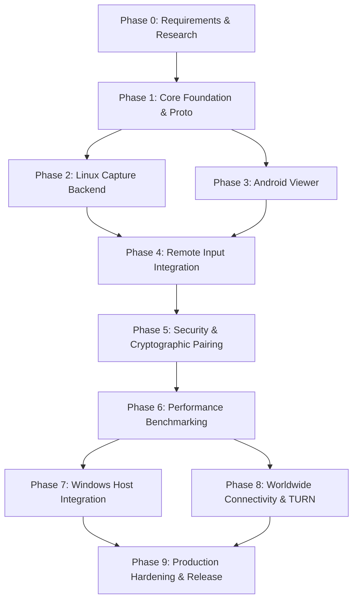

# Engineering Roadmap & Milestone Exit Criteria: Remote-Desk Platform

| Document Metadata | Details |
|---|---|
| **Document ID** | RD-SPEC-ROADMAP-009 |
| **Author / Agent** | Integration Owner & Technical Lead Agent |
| **Lifecycle Standard** | ISO/IEC/IEEE 12207:2026 Milestone Model |
| **Phases** | Phase 0 (Specs) through Phase 9 (Hardening) |
| **Status** | Approved Master Roadmap |

---

## 1. Roadmap Architecture & Dependency Graph

Remote-Desk development is organized into 10 structured milestone phases. To prevent conflicting architectures and unverified claims of completion, each phase possesses strict input prerequisites, clear deliverables, and mandatory exit criteria.

---

## 2. Milestone Phases & Detailed Exit Criteria

### Phase 0: Requirements & Research (Current Phase)
- **Primary Deliverables**:
  - `requirements.md` (Architecture Agent)
  - `reference-study.md` (UI/UX Agent)
  - `ui-spec.md` (UI/UX Agent)
  - `architecture.md` (Architecture Agent)
  - `threat-model.md` (Security Agent)
  - `protocol.md` (Networking Agent)
  - `verification-plan.md` (QA Agent)
  - `benchmark-plan.md` (Performance Agent)
  - `roadmap.md` (Integration Owner)
- **Exit Criteria**:
  - [x] All 9 specification documents completed and peer-reviewed.
  - [x] Every critical requirement assigned a unique identifier (`REQ-*`) and verification method.
  - [x] Zero architectural contradictions between UI gestures, protocol framing, and security threat model.
  - [x] OpenSpec change scaffolded and aligned (`init-remote-desk-core`).

---

### Phase 1: Core Foundation & Shared Protocols
- **Scope & Tasks**:
  - Establish Cargo workspace (`Cargo.toml`) with standard workspace dependencies (`tokio`, `serde`, `bincode`, `ed25519-dalek`, `x25519-dalek`, `thiserror`).
  - Configure code formatting (`rustfmt.toml`), pedantic linting (`clippy`), and CI workflows.
  - Implement `crates/remote-desk-proto` containing versioned message definitions, binary header serializer, and round-trip codecs.
  - Implement `crates/remote-desk-core` containing Ed25519 identity key generation, SAS calculations, and session state machine.
- **Exit Criteria**:
  - Reproducible builds across Linux (`x86_64`) and Android (`aarch64`).
  - Automated unit test suite passes 100% (`cargo test --workspace`).
  - Zero clippy warnings with `-D warnings`.

---

### Phase 2: Linux Capture Backend
- **Scope & Tasks**:
  - Implement `crates/remote-desk-linux`.
  - Wayland capture using `org.freedesktop.portal.ScreenCast` and PipeWire DMA-BUF buffer listener.
  - X11 fallback capture using MIT-SHM (`XShmGetImage`) on legacy display servers.
  - Monitor enumeration and dynamic resolution change detection.
- **Exit Criteria**:
  - Captured frames can be pulled and rendered locally in a test loopback window.
  - System portal permission rejection is handled gracefully without crashing or panicking.
  - Automated integration test passes against headless Xvfb display.

---

### Phase 3: Android Viewer Client
- **Scope & Tasks**:
  - Implement `android/` Jetpack Compose application.
  - Build UI surfaces: Devices List (Screen A), Add Computer (Screen B), Connection Progress (Screen C), Active Session (Screen D), Settings (Screen E).
  - Integrate WebRTC Android library (`libwebrtc`) with `SurfaceViewRenderer`.
  - Wire protocol codec connecting Android Kotlin to `remote-desk-proto` and host daemon.
- **Exit Criteria**:
  - Android application displays a live video stream from a Linux host over LAN.
  - Screen orientation switches (portrait to landscape) preserve aspect ratio without crashing.
  - Active memory consumption remains < 120 MB RSS on mobile device.

---

### Phase 4: Remote Input & Gesture Processing
- **Scope & Tasks**:
  - Implement touch-to-pointer gesture recognizer on Android (Direct-Touch and Pointer modes).
  - Transmit input events over WebRTC SCTP DataChannel (`remote-desk-input`).
  - Linux input injection via `org.freedesktop.portal.RemoteDesktop` and `/dev/uinput`.
  - Absolute coordinate normalization and relative pointer delta mapping.
  - Stuck-key fail-safe release engine (`release_all()`).
- **Exit Criteria**:
  - Single tap, double tap, right click, two-finger scroll, and drag-and-drop operate reliably.
  - Terminating controller connection while keys are pressed instantly releases all held keys on the host.
  - Zero stuck keys verified by automated test harness.

---

### Phase 5: Cryptographic Security & Mutual Pairing
- **Scope & Tasks**:
  - Implement cryptographic mutual pairing workflow:
    - 6-digit Short Authentication String (SAS) calculation and verification dialogs.
    - Public key pinning in local encrypted storage.
  - Session authentication challenge-response (`AuthChallenge` / `AuthResponse`).
  - End-to-end SRTP (DTLS 1.3) and SCTP payload validation.
  - Adversarial fuzzing against binary protocol parser.
- **Exit Criteria**:
  - Unpaired devices cannot initiate video streaming or inject input.
  - Man-in-the-middle attacks detected and flagged via SAS fingerprint mismatch.
  - OWASP MASVS-L1 compliance audit verified.

---

### Phase 6: Performance Optimization & Latency Benchmarking
- **Scope & Tasks**:
  - Instrument end-to-end glass-to-glass latency measurement harness.
  - Profile hardware encoder pipelines (VA-API / NVENC vs software x264).
  - Eliminate buffer bloat and redundant memory copies in DMA-BUF pipeline.
  - Execute 10 standardized workloads (`WL-01` through `WL-10`).
- **Exit Criteria**:
  - LAN median latency < 35ms, P95 < 60ms at 1080p60.
  - Idle host CPU usage < 0.5% (single core); memory footprint < 60 MB RSS.
  - Comparative benchmark report published against Microsoft RD, CRD, and RustDesk.

---

### Phase 7: Windows Host Integration
- **Scope & Tasks**:
  - Implement `crates/remote-desk-windows`.
  - Native screen capture using DXGI Desktop Duplication (`IDXGIOutputDuplication`) and Windows Graphics Capture.
  - Input injection using Win32 `SendInput` API.
  - Validate Windows-to-Android and Windows-to-Linux remote sessions.
- **Exit Criteria**:
  - Windows host streams 1080p60 with < 5ms capture latency per frame.
  - Shared session and protocol crates operate unchanged on Windows.

---

### Phase 8: Worldwide Connectivity & TURN Relay
- **Scope & Tasks**:
  - Implement lightweight, self-hostable rendezvous signaling server.
  - Full ICE negotiation supporting STUN (server-reflexive) and TURN (relay fallback).
  - Test NAT traversal across Symmetric NAT, CGNAT, and restrictive corporate firewalls.
- **Exit Criteria**:
  - Remote desktop sessions connect across distinct cellular/WAN networks.
  - TURN relay traffic remains 100% end-to-end encrypted; relay server cannot inspect payloads.
  - Connection failures return actionable diagnostic error messages.

---

### Phase 9: Production Hardening, Packaging & Release
- **Scope & Tasks**:
  - Package Linux host: Flatpak, Debian (`.deb`), RPM, Arch PKGBUILD, AppImage.
  - Package Windows host: MSI installer with automated background service option.
  - Package Android controller: Google Play / F-Droid release APK / AAB.
  - Final security audit, penetration test, and vulnerability disclosure policy (`SECURITY.md`).
- **Exit Criteria**:
  - Clean automated release pipeline producing signed binary artifacts.
  - Documentation and user manuals complete.
  - Standards register finalized with external audit evidence.
